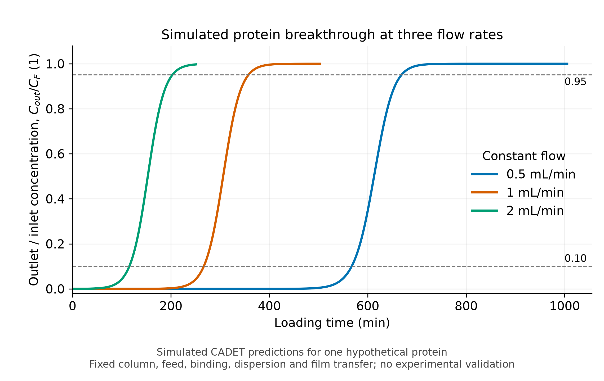
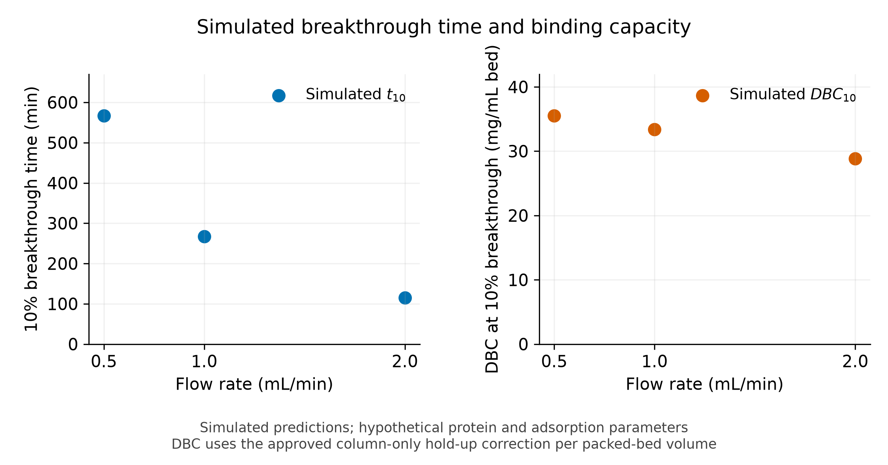

# Chromatography loading: simulated breakthrough and binding capacity

**All breakthrough curves and capacities in this repository are synthetic simulation predictions. They are not experimental measurements or validated commercial resin performance.**

This study compares constant step loading of one hypothetical protein onto a fixed packed column at **0.5, 1.0, and 2.0 mL/min**. It supports model evaluation and comparison of simulated conditions, without establishing resin selection, process validation, or scale-up validity.

## Research Questions

### Primary research question

How does volumetric flow rate influence simulated protein breakthrough behavior and dynamic binding capacity at 10% breakthrough in a fixed packed-bed chromatography column?

### Secondary research questions

1. How do breakthrough time, loaded feed volume, and nominal residence time differ at flow rates of 0.5, 1.0, and 2.0 mL/min?
2. How does predicted DBC₁₀ vary across these flow rates using a consistent column-only hold-up correction?
3. To what extent do mass conservation and numerical convergence tests support the reliability of the simulated breakthrough and DBC₁₀ predictions?

## Repository map

| File | Purpose |
| --- | --- |
| `chromatography_study.py` | Model, interpolation, mass accounting, sequential refinement, acceptance checks, and output generation |
| `test_chromatography_study.py` | Standard-library `unittest` checks for calculations, selection rules, and generated outputs |
| `requirements.txt` | Exact scientific Python dependency pins |
| `results/parameters.csv` | Physical and numerical parameters, units, CADET mappings, provenance, and rationale |
| `results/summary.csv` | Simulated metrics, mass residuals, refinement ledger, selected settings, and acceptance status |
| `results/breakthrough_curves.csv` | Raw simulated concentration series and cumulative/remaining protein masses |
| `results/simulated_breakthrough_comparison.png` | Simulated breakthrough overlay |
| `results/simulated_t10_dbc10_comparison.png` | Simulated breakthrough-time and capacity comparison |

## Setup and reproduction

Verified: **Python 3.12.14**, **CADET-Process 0.12.0**, **CADET-Core 5.1.1**, and CADET-Python 1.3.0. Other pins are in `requirements.txt`; Core is discovered from its installed package.

For a fresh checkout on Windows PowerShell, with [uv](https://docs.astral.sh/uv/) available:

```powershell
uv venv --python 3.12.14 .venv
Set-ExecutionPolicy -Scope Process -ExecutionPolicy Bypass
. .\.venv\Scripts\Activate.ps1
uv pip install --python .venv\Scripts\python.exe -r requirements.txt cadet-core==5.1.1 cadet-python==1.3.0
cadet-cli --version
```

For the existing local environment, activate `.venv` and run:

```powershell
python chromatography_study.py --run
python chromatography_study.py --smoke
python -m unittest -v
```

`--run` recreates the five outputs after refinement, production, and acceptance checks. `--smoke` checks all flows at baseline settings without writing results. Run the study before tests, which inspect generated outputs. The source notebook is not required at runtime.

The fixed seed is **20261025** for Python's `random` and NumPy. The model itself is deterministic; CADET-Core runs with one solver thread.

## Model and parameter provenance

CADET-Process executes a CADET-Core **lumped-rate model with pores**, axial dispersion, film mass transfer, and **kinetic Langmuir adsorption** for one component. The initially solute-free column is isothermal, with spherical particles and accessible pore liquid. A constant-concentration step continues until the raw final outlet/inlet ratio reaches at least **0.95**.

Geometry, porosities, feed, kinetics, and initial conditions are identical across flows. Dispersion stays at **2e-7 m²/s** and film mass transfer at **1e-4 m/s**, without flow correlations.

The consolidated [parameter table](results/parameters.csv) distinguishes:

- **Sourced:** geometry, porosities, and particle radius from the cited CADET Workshop example.
- **Adapted:** workshop dispersion and film coefficients; applicability to this hypothetical protein is assumed.
- **Assumed:** protein molar mass **50 kg/mol**, feed **0.020 mol/m³ liquid** (equivalent to **1 mg/mL**), capacity **2 mol/m³ particle solid**, adsorption rate **0.050 m³/(mol·s)**, and desorption rate **1e-4 s⁻¹**.
- **Derived:** volumes, equilibrium coefficient, conversions, and numerical selections.

## Calculations and units

Native units are metres, seconds, moles, and cubic metres. Concentrations use liquid volume; adsorbed loading uses particle-solid volume, excluding pores. Molar amounts convert to mass using the assumed molar mass.

For reporting, let $Q$ be flow in mL/s, $t_{10}$ the simulated first 10% breakthrough time in seconds, $C_F$ feed concentration in mg/mL, and $V_{bed}$ geometric packed-bed volume in mL. The displayed mL/min flow is divided by 60 before these calculations. With interstitial porosity $\varepsilon_c$ and particle porosity $\varepsilon_p$:

$$
V_{F,10}=Qt_{10},\qquad t_R=\frac{V_{bed}}{Q}
$$

$$
V_H=V_{bed}\left[\varepsilon_c+(1-\varepsilon_c)\varepsilon_p\right],\qquad
DBC_{10}=\frac{C_F\left(V_{F,10}-V_H\right)}{V_{bed}}
$$

$V_{F,10}$ and $V_H$ are in mL; $t_R$ is in seconds; simulated $DBC_{10}$ is in **mg/mL packed bed**. Rounded volumes are $V_{bed}=7.853982$ mL and $V_H=4.538816$ mL. This feed-volume hold-up correction assumes accessible column liquid and excludes all extra-column volumes; it does not integrate effluent loss.

For $R=C_{out}/C_F$, the first pair satisfying $R_i<0.10\leq R_{i+1}$ gives:

$$
t_{10}=t_i+\frac{0.10-R_i}{R_{i+1}-R_i}(t_{i+1}-t_i)
$$

The first crossing is interpolated, never chosen by nearest sample.

## Numerical verification

Refinement follows **output sampling → axial grid → solver tolerances**. Each factor runs at all levels and flows, holding others at baseline or previously selected settings. No Cartesian grid is run.

| Factor | Prescribed levels | Baseline | Selected production setting |
| --- | --- | --- | --- |
| Samples per nominal residence time | 100, 200, 400 | 200 | 100 |
| Axial finite-volume cells | 20, 40, 80 | 40 | 40 |
| `(rtol, atol)` | `(1e-6, 1e-8)`, `(1e-7, 1e-9)`, `(1e-8, 1e-10)` | `(1e-7, 1e-9)` | `(1e-6, 1e-8)` |

`rtol` is dimensionless; `atol` uses native mol/m³ units. Convergence requires both simulated $t_{10}$ and $DBC_{10}$ to change by at most **1.0%** between the two finest levels at every flow, relative to the finest. Then select the coarsest level within that tolerance of the finest for both metrics at all flows. Otherwise, select the finest prescribed level and disclose unresolved sensitivity.

**All factors converged; none has unresolved sensitivity.** The largest two-finest-level change is **0.296457%**. `summary.csv` retains per-level values and deltas.

Raw curves must be finite, bracket 0.10, and finish at or above 0.95. The dimensionless monotonicity allowance is `max(1e-6, 4*atol/C_F)` with native $C_F$: **2e-6** for production. This screening allowance is not a rigorous error bound. Curves are never smoothed, clipped, or replaced.

Inlet/outlet masses use trapezoidal integration of raw samples. Finite-volume inventories separately weight interstitial liquid, pore liquid, and particle solid. At interpolated $t_{10}$, integration includes the partial interval and inventories are interpolated to the same time. The signed normalized residual is:

$$
r_M=\frac{M_{in}-M_{out}-M_{liquid}-M_{adsorbed}}{M_{in}}
$$

Masses are in mg. Acceptance requires $|r_M|\leq0.01$ at simulated breakthrough and simulation end for every flow. The largest absolute residual is **3.11093e-7** of cumulative inlet mass. Checks also compare exports with raw states and verify units, volumes, selections, and CSV round trips.

## Simulated results and findings

Rounded directly from [results/summary.csv](results/summary.csv); all entries are simulated predictions.

| Flow (mL/min) | Simulated $t_{10}$ (s) | Loaded feed (mL) | Nominal residence time (s) | Simulated $DBC_{10}$ (mg/mL bed) | Final $C_{out}/C_F$ (1) |
| ---: | ---: | ---: | ---: | ---: | ---: |
| 0.5 | 34039.610 | 283.663 | 942.478 | 35.539 | 1.000000 |
| 1.0 | 16007.797 | 266.797 | 471.239 | 33.392 | 0.999990 |
| 2.0 | 6928.755 | 230.959 | 235.619 | 28.829 | 0.997114 |



*Simulated breakthrough curves for one hypothetical protein; all plotted concentrations are synthetic CADET outputs.*



*Simulated breakthrough time and simulated DBC by flow rate, using the column-only hold-up correction.*

For this hypothetical parameter set, higher flow reduces simulated breakthrough time, loaded volume at breakthrough, and simulated DBC. Every simulated curve reaches the completion target; findings apply only to this model and parameter set.

## Interpretation of Results

### Primary question: Overall effect of flow rate

For the fixed column and hypothetical parameter set, increasing flow from 0.5 to 2.0 mL/min produces earlier simulated 10% breakthrough and an 18.882% decrease in simulated DBC₁₀. The capacity comparison depends on the lower loaded feed volume under the common feed concentration and hold-up correction. Shorter breakthrough time alone would not establish lower capacity, because flow also increases. These observed simulation trends do not independently isolate adsorption kinetics, film transfer, or dispersion as their cause.

### Secondary question 1: Breakthrough time, loaded volume, and residence time

In flow order 0.5, 1.0, and 2.0 mL/min, the [existing simulated results table](#simulated-results-and-findings) reports:

- Interpolated 10% breakthrough times: **34039.610, 16007.797, and 6928.755 s**.
- Loaded feed volumes at 10% breakthrough: **283.663, 266.797, and 230.959 mL**.
- Nominal residence times: **942.478, 471.239, and 235.619 s**.

Calculated from the full-precision [summary values](results/summary.csv) as `100 * (value_at_0.5 - value_at_2.0) / value_at_0.5`, the endpoint decreases are **79.645%**, **18.580%**, and **75.000%**, respectively. Nominal residence time follows $t_R=V_{bed}/Q$, with flow converted to mL/s; quadrupling flow therefore quarters residence time for this fixed bed.

### Secondary question 2: DBC₁₀ and the hold-up correction

The simulated DBC₁₀ values are **35.539, 33.392, and 28.829 mg/mL packed bed** at 0.5, 1.0, and 2.0 mL/min, respectively: an **18.882%** endpoint decrease using full-precision CSV values. All flows use the same **1 mg/mL** feed concentration, **7.853982 mL** packed-bed volume, and **4.538816 mL** column-only hold-up volume (volumes rounded here); see the [parameter records](results/parameters.csv) and [summary](results/summary.csv).

This is the same feed-volume-based, hold-up-corrected estimate $DBC_{10}=C_F(Qt_{10}-V_H)/V_{bed}$ in mg/mL packed bed at every flow. It does not subtract integrated effluent loss and is not identical to the directly calculated adsorbed inventory at breakthrough divided by packed-bed volume.

### Secondary question 3: Numerical reliability and its limits

Every flow satisfies the absolute normalized mass-balance criterion **≤0.01 (1%)** at both interpolated 10% breakthrough and simulation end. Across those evaluations, the largest absolute residual is **3.11093e-7** of cumulative inlet mass, or **0.0000311093%**, at simulation end for 1.0 mL/min.

Output sampling, axial grid, and solver tolerances each meet the **1.0%** two-finest-level convergence criterion for both simulated breakthrough time and DBC₁₀ at every flow. The largest recorded relative change is **0.296457%**, for DBC₁₀ during axial-grid refinement at 0.5 mL/min. All unresolved-sensitivity disclosure fields are `none`; the supporting deltas and residuals are in [summary.csv](results/summary.csv).

These checks support numerical consistency within the specified model and tested settings. They do not experimentally validate the hypothetical protein–resin system or guarantee results within 1% of a true physical value. Sequential one-factor refinement does not establish convergence for every possible combination of numerical settings.

## Assumptions and limitations

The hypothetical feed and kinetic parameters are not fitted or experimentally validated. The lumped-rate approximation omits intraparticle pore-diffusion gradients, and fixed dispersion/film coefficients omit possible flow dependence. Results depend on the chosen model, feed, parameters, discretization, and hold-up definition. No multicomponent competition, gradients, washing, elution, cycling, fouling, degradation, pressure drop, uncertainty study, or scale-up model is included. Simulated capacities must not be interpreted as measured protein–resin performance or used to rank commercial resins.

## Attribution

- **CADET Workshop contributors:** [“Example 2: Multi-component Langmuir Separation,” *Simple Chromatographic Processes*](https://github.com/cadet/CADET-Workshop/blob/90b52ddb723d9adf6aaa22acd92fa610eacb6e8d/03%20Process%20Simulation/03.1%20Simple%20Chromatographic%20Processes/03.1.1_chromatography.md). The linked historical text documents the geometry and transport values in the supplied `03.1.1_chromatography.ipynb`, code cell 18 (zero-based). The supplied notebook snapshot is identified in the parameter table by SHA256 `bbabfa9503e24963ee8cbb306bf4887aa14031835d5ea84f0a9ede5d11572246`. This study changes the example to one hypothetical protein, constant loading, and assumed kinetic binding parameters.
- **CADET-Process contributors:** [version 0.12.0 documentation](https://cadet-process.readthedocs.io/en/v0.12.0/), the model-building and simulation interface used here.
- **CADET-Core contributors:** version 5.1.1 solver; the [LRMP equations and boundary conditions](https://cadet.github.io/v5.1.X/modelling/unit_operations/lumped_rate_model_with_pores.html) and [Langmuir binding equations](https://cadet.github.io/v5.1.X/modelling/binding/multi_component_langmuir.html) document the methods implemented here. The binding API name supports multiple components, but this study configures exactly one.
- **SciPy contributors:** [`cumulative_trapezoid` documentation](https://docs.scipy.org/doc/scipy-1.17.0/reference/generated/scipy.integrate.cumulative_trapezoid.html), the method used for cumulative inlet/outlet mass integration.

Hypothetical protein, feed, and binding values are explicit assumptions; no additional literature-derived performance values are used.
